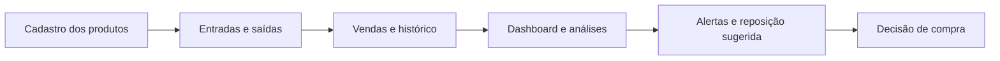
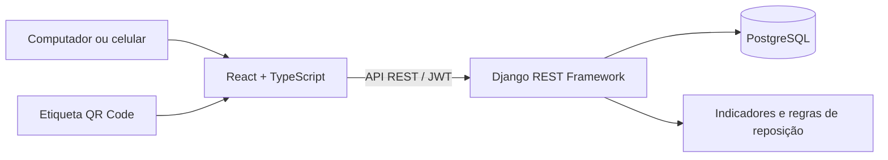

<div align="center">

# 📦 AutoStock

### Mais controle do estoque. Menos perdas. Melhores decisões de compra.

**Plataforma de gestão e análise de estoque desenvolvida para o mercado de autopeças.**

[](https://autostock-web.onrender.com)
[](https://github.com/LucasLoman/Projeto-Integrador-VI/actions)

**[🌐 Plataforma online](https://autostock-web.onrender.com)** · **[⚙️ Tecnologias](#-tecnologia-e-arquitetura)** · **[🚀 Executar localmente](#-executar-o-projeto)**

*Controle de produtos, movimentações, vendas e reposição em um só lugar.*

</div>

---

## O que é o AutoStock?

O **AutoStock** é uma plataforma web que ajuda lojas de autopeças a organizar seu estoque e transformar dados de vendas em decisões de compra mais consistentes.

Além do cadastro de produtos e do registro de movimentações, a solução reúne indicadores para identificar **itens com pouca saída**, acompanhar **produtos próximos de acabar** e calcular **sugestões de reposição** considerando o consumo e o prazo de entrega dos fornecedores.

O resultado é uma visão mais clara do que está acontecendo no estoque — do balcão à gestão.

> **Conheça a plataforma:** [autostock-web.onrender.com](https://autostock-web.onrender.com)  
> O acesso exige usuário autorizado. O AutoStock é um **MVP funcional em evolução**, não uma oferta comercial com contratação disponível nesta etapa.

## Por que o AutoStock?

Uma loja de autopeças lida com centenas ou milhares de itens, diferentes marcas e variações de demanda. Sem informações organizadas, surgem problemas conhecidos:

- **Falta de peças:** o cliente procura um item que já acabou;
- **Capital parado:** mercadorias ficam muito tempo sem vender;
- **Compras imprecisas:** repõe-se demais um produto e de menos outro;
- **Baixa visibilidade:** é difícil acompanhar o que entra, sai e vende;
- **Tempo perdido:** localizar peças e consultar o histórico leva mais tempo do que deveria.

O AutoStock foi concebido para apoiar a solução desses desafios por meio de **controle operacional, indicadores acessíveis e recomendações baseadas em dados**.

## O que a plataforma oferece

| Funcionalidade | Valor para a operação |
| --- | --- |
| **Gestão de produtos** | Organize peças por SKU, descrição, marca, categoria, fornecedor e localização. |
| **Entradas, saídas e ajustes** | Mantenha o histórico de movimentações e os saldos atualizados. |
| **Registro de vendas** | Registre os itens vendidos com baixa automática no estoque. |
| **Estoque mínimo** | Identifique produtos em atenção e itens sem saldo. |
| **Dashboard gerencial** | Visualize vendas, faturamento, valor estimado do estoque e indicadores relevantes. |
| **Curva ABC** | Saiba quais produtos representam maior participação no faturamento. |
| **Produtos parados** | Encontre itens sem vendas no período e estime o capital imobilizado. |
| **Previsão de ruptura** | Estime a cobertura em dias e identifique risco de falta de mercadorias. |
| **Sugestão de reposição** | Consulte quantidades indicadas para compra e custo estimado, conforme parâmetros do estoque. |
| **QR Code por produto** | Gere etiquetas para acessar rapidamente a ficha da peça pelo celular. |

### Um fluxo pensado para o dia a dia



### QR Code: a informação na ponta da câmera

O AutoStock permite gerar um QR Code vinculado à página de um produto. A etiqueta pode ser salva ou impressa e utilizada na peça, caixa ou prateleira. Ao escanear, o usuário autorizado acessa informações como **SKU, descrição, localização e estoque**.

Não é necessário instalar sensores ou equipamentos IoT: o recurso funciona com a câmera do celular e o navegador.

## Inteligência aplicada ao estoque

O diferencial do AutoStock está em transformar registros de movimentação e venda em **indicadores que apoiam o planejamento de compras**.

**Consumo médio diário**

```text
Unidades vendidas no período ÷ quantidade de dias analisados
```

**Cobertura de estoque**

```text
Quantidade disponível ÷ consumo médio diário = cobertura em dias
```

**Reposição recomendada**

O sistema considera o consumo recente, o estoque mínimo, uma margem de segurança e o prazo do fornecedor para estimar o ponto de reposição e o estoque desejado.

**Exemplo ilustrativo:**

| Indicador | Valor |
| --- | ---: |
| Estoque disponível | 8 unidades |
| Consumo médio | 2 unidades/dia |
| Prazo de entrega | 7 dias |
| Estoque de segurança calculado | 6 unidades |
| Ponto de reposição | 20 unidades |
| Estoque alvo | 50 unidades |
| **Sugestão de compra** | **42 unidades** |

A recomendação é **calculada**, não um pedido de compra automático. Produtos sem giro não recebem sugestão automática de reposição; a decisão final permanece com o responsável pelo estoque.

**Curva ABC:** os produtos são classificados conforme sua participação acumulada no faturamento, com faixas de referência próximas de **80% (A)**, **15% (B)** e **5% (C)**. Isso ajuda a priorizar itens mais relevantes para o negócio.

> As análises utilizam cálculos determinísticos sobre o histórico disponível. Não se trata de uma previsão por IA treinada, nem de garantia de demanda futura. Sazonalidade, promoções e particularidades dos fornecedores também precisam ser consideradas.

## Tecnologia e arquitetura

O AutoStock utiliza tecnologias amplamente adotadas no desenvolvimento de aplicações web, com separação entre interface, regras de negócio e banco de dados.

| Camada | Tecnologias |
| --- | --- |
| **Interface** | React, TypeScript, Vite e React Router |
| **Comunicação** | Axios e API REST |
| **Gráficos** | Recharts |
| **QR Code** | qrcode.react |
| **Backend** | Python, Django e Django REST Framework |
| **Autenticação** | JWT (Simple JWT) |
| **Banco de dados** | PostgreSQL |
| **Ambiente local** | Docker e Docker Compose |
| **Qualidade** | Pytest, Vitest e React Testing Library |
| **CI/CD** | GitHub Actions |
| **Hospedagem** | Render, Gunicorn e WhiteNoise |



### Organização do código

```text
Projeto-Integrador-VI/
├── backend/
│   ├── autostock/           # Configurações e rotas Django
│   ├── inventory/           # Modelos, APIs e regras de estoque
│   ├── tests/               # Testes de integração
│   └── requirements.txt
├── frontend/
│   ├── src/pages/           # Telas da plataforma
│   ├── src/test/            # Testes de interface
│   └── package.json
├── .github/workflows/       # Integração contínua
├── docs/                    # Documentação complementar
├── docker-compose.yml       # Ambiente local
├── render.yaml              # Deploy na nuvem
├── .env.example             # Exemplo de configuração
└── README.md
```

## Executar o projeto

### Pré-requisitos

- Git;
- Docker Desktop com Docker Compose;
- No Windows, WSL 2 configurado para o Docker Desktop.

### 1. Clonar o repositório

```bash
git clone https://github.com/LucasLoman/Projeto-Integrador-VI.git
cd Projeto-Integrador-VI
```

### 2. Configurar o ambiente

Crie um `.env` na raiz a partir do modelo `.env.example`.

**Windows (CMD):**

```cmd
copy .env.example .env
```

**Linux, macOS ou Git Bash:**

```bash
cp .env.example .env
```

Revise as configurações e defina valores próprios para `POSTGRES_PASSWORD` e `DJANGO_SECRET_KEY`.

> Nunca publique o arquivo `.env` ou credenciais reais no GitHub. Use o `.env.example` somente como referência.

### 3. Iniciar a aplicação

```bash
docker compose up -d --build
```

Confirme que os serviços estão ativos:

```bash
docker compose ps
```

### 4. Criar um administrador local

```bash
docker compose exec backend python manage.py createsuperuser
```

### 5. Acessar

| Serviço | URL local |
| --- | --- |
| **Plataforma AutoStock** | http://localhost:5173 |
| **API REST** | http://localhost:8000/api/ |
| **Painel administrativo Django** | http://localhost:8000/admin/ |
| **Health check** | http://localhost:8000/health/ |

### Comandos úteis

```bash
# Acompanhar os logs
docker compose logs -f

# Executar os testes do backend
docker compose exec backend pytest -v

# Executar os testes do frontend
docker compose exec frontend npm test

# Parar sem remover os dados persistidos
docker compose down
```

**Atenção:** `docker compose down -v` remove volumes do projeto e pode apagar o banco local.

## API REST

A API disponibiliza os recursos operacionais e analíticos da plataforma. As principais rotas incluem:

| Recurso | Endpoint |
| --- | --- |
| Autenticação | `POST /api/auth/token/` |
| Renovação de token | `POST /api/auth/token/refresh/` |
| Produtos | `/api/products/` |
| Categorias | `/api/categories/` |
| Marcas | `/api/brands/` |
| Fornecedores | `/api/suppliers/` |
| Movimentações | `/api/movements/` |
| Vendas | `/api/sales/` |
| Dashboard | `GET /api/dashboard/` |
| Curva ABC | `GET /api/analytics/abc/` |
| Produtos parados | `GET /api/analytics/slow-products/` |
| Risco de ruptura | `GET /api/analytics/rupture-forecast/` |
| Reposição sugerida | `GET /api/analytics/replenishment/` |

As rotas protegidas usam `Authorization: Bearer <token>`.

## Qualidade e publicação

O AutoStock possui testes automatizados para API e frontend. O workflow de **GitHub Actions** verifica testes, build da interface e configuração Docker em alterações nas branches de integração.

- **[Acompanhar verificações de código](https://github.com/LucasLoman/Projeto-Integrador-VI/actions)**
- **[Acessar a versão publicada](https://autostock-web.onrender.com)**

A publicação é definida por `render.yaml`, com serviços para o frontend, a API Django e o PostgreSQL. Consulte [`docs/DEPLOY_RENDER.md`](docs/DEPLOY_RENDER.md) para detalhes técnicos de implantação.

**Importante:** a versão online é uma demonstração com acesso autorizado. A disponibilidade e a retenção de dados estão sujeitas às condições da hospedagem. A implantação comercial requer revisão de backups, segurança, LGPD, permissões e infraestrutura.

## Próximos passos

O AutoStock foi projetado para evoluir conforme as necessidades da operação. Entre as possibilidades de expansão estão:

- Integração com sistemas de venda e ERP já utilizados pelas lojas;
- Importação e exportação de produtos e movimentações;
- Relatórios gerenciais para download;
- Permissões específicas por função;
- Melhorias nas análises de sazonalidade e comportamento de demanda;
- Implantação assistida e estrutura de atendimento para múltiplos clientes.

A possibilidade de comercialização no modelo **SaaS (Software as a Service)** faz parte da visão de evolução do produto. **O MVP atual não possui planos pagos ou cobrança de assinaturas.**

## Origem e equipe

O AutoStock nasceu de uma parceria com a **AutoIta Peças e Acessórios**, em **Itararé/SP**, como iniciativa de desenvolvimento aplicado do curso de **Engenharia de Computação da Universidade Virtual do Estado de São Paulo (UNIVESP)**, no **Projeto Integrador VI**. O orientador é **Marcel Ryuichi Sunano**.

<details>
<summary><strong>Ver equipe de desenvolvimento</strong></summary>

| Integrante | RA |
| --- | --- |
| Maicom Custódio da Silva | 1713591 |
| Matheus Henrique Alves de Oliveira | 2202255 |
| Lucas Loman Mazorca | 2201956 |
| Juliane Lima | 2104122 |
| Elaine Cox da Silva | 2108427 |
| Simone Correa de Souza | 23218925 |
| Anthony de Jesus Valentim | 2224720 |
| Jefferson Felipe da Silva Gouveia de Paula | 2104133 |

</details>

O desenvolvimento envolveu integrantes dos polos de Itararé, Avaré, Itapeva, Capão Bonito e Iporanga.

## Licenciamento

Este repositório não apresenta uma licença de software explicitamente definida. Direitos de uso, cópia e distribuição devem ser confirmados com os responsáveis pelo projeto.

---

<div align="center">

### AutoStock

**Informação certa para comprar melhor.**

[**Acessar plataforma**](https://autostock-web.onrender.com) · [**Conhecer o código**](https://github.com/LucasLoman/Projeto-Integrador-VI)

</div>
